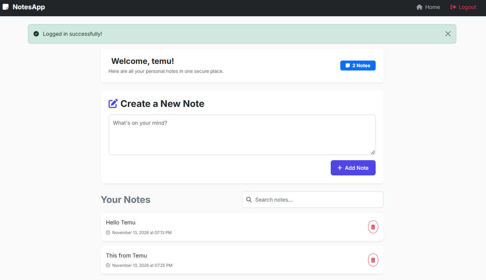
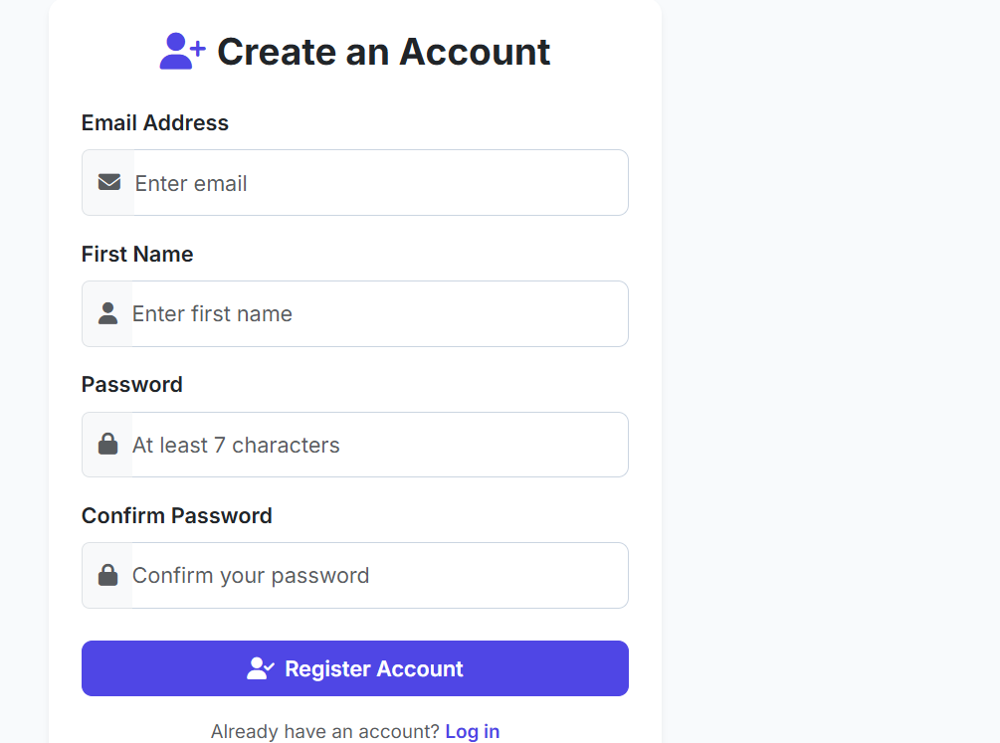

# 📝 Modern Flask Note-Taking Application

A secure, feature-rich, and aesthetically pleasing web-based note-taking application built with **Python**, **Flask**, and **SQLite**. It features user authentication, full CRUD operations, live real-time searching, formatted creation timestamps, and a modern responsive user interface styled with **Bootstrap 5** and custom card designs.

---

## 📸 Screenshots

| Dashboard & Notes View | Login Interface |
| :---: | :---: |
|  |  |

---

## ✨ Features

- **🔐 Secure Authentication:** User registration, encrypted password hashing (`Werkzeug`), session management (`Flask-Login`), and protected routes.
- **📝 Note Management:** Create, view, and delete personal notes dynamically associated with individual user accounts.
- **🔍 Live Real-Time Search:** Instantly filter through your notes as you type using client-side JavaScript without page reloads.
- **⏰ Timestamps:** Automatically tracks and displays the exact creation date and time for every note.
- **🎨 Modern UI/UX:** Clean card-based design, smooth transition animations, custom typography (`Inter` font), and Font Awesome icons.

---

## 🛠️ Tech Stack

- **Backend:** Python, Flask, Flask-SQLAlchemy, Flask-Login, Werkzeug
- **Database:** SQLite
- **Frontend:** HTML5, Jinja2 Templates, Bootstrap 5, Custom CSS
- **Interactivity:** Vanilla JavaScript (Fetch API, DOM manipulation, real-time event listeners)

---

## 📂 Project Structure

```text
my_flask_app/
│
├── main.py                   # Application entry point
├── assets/                   # Screenshots & visual assets
│   ├── dashboard.png
│   └── login.png
└── website/                  # Application package
    ├── __init__.py           # App factory & extension initialization
    ├── auth.py               # Authentication blueprint (Login/Signup/Logout)
    ├── views.py              # Main views blueprint (Home & Delete Note)
    ├── models.py             # SQLAlchemy database models (User & Note)
    └── templates/            # HTML templates (Jinja2)
        ├── base.html         # Base layout with navbar & flash alerts
        ├── home.html         # Dashboard, note feed, search bar, & JavaScript logic
        ├── login.html        # Modern login interface with icons
        └── sign_up.html      # User registration interface with icons